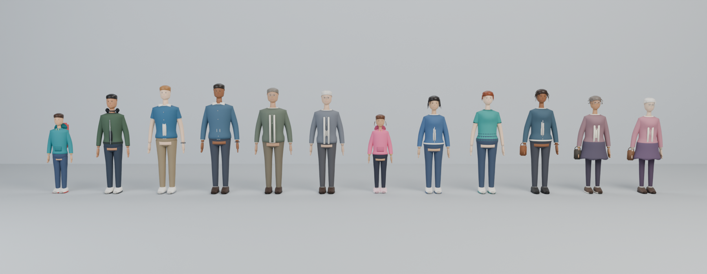

# FRESH MART customers — 12 rigged characters

Twelve fully rigged, animated supermarket shoppers authored in Blender 5.2 and
exported to glTF 2.0 for the Three.js game. Six male, six female, covering
children, teenagers, young adults, adults, middle-aged adults and seniors —
each with a unique face, hair, silhouette, outfit, palette and accessories.




## Roster

| ID                   | Character                             | Age group   | Height | Carry  | Spawn weight |
| -------------------- | ------------------------------------- | ----------- | -----: | ------ | -----------: |
| `male_customer_01`   | Young Boy (hoodie, backpack)          | child       | 1.31 m | —      |          0.9 |
| `male_customer_02`   | Teenage Boy (bomber, headphones)      | teen        | 1.63 m | —      |          1.2 |
| `male_customer_03`   | Young Man (polo, hand basket)         | young adult | 1.77 m | basket |          1.6 |
| `male_customer_04`   | Adult Man (shirt, watch)              | adult       | 1.80 m | —      |          1.4 |
| `male_customer_05`   | Middle-Aged Man (cardigan, moustache) | middle-aged | 1.73 m | cart   |          1.4 |
| `male_customer_06`   | Elderly Man (cardigan, glasses)       | senior      | 1.69 m | —      |          1.1 |
| `female_customer_01` | Young Girl (puffer, pigtails)         | child       | 1.29 m | —      |          0.9 |
| `female_customer_02` | Teenage Girl (jacket, necklace)       | teen        | 1.60 m | —      |          1.2 |
| `female_customer_03` | Young Woman (tee, hand basket)        | young adult | 1.68 m | basket |          1.6 |
| `female_customer_04` | Adult Woman (jacket, tote)            | adult       | 1.71 m | —      |          1.4 |
| `female_customer_05` | Middle-Aged Woman (cardigan, glasses) | middle-aged | 1.60 m | cart   |          1.4 |
| `female_customer_06` | Elderly Woman (cardigan, handbag)     | senior      | 1.57 m | —      |          1.1 |

Weights add up to 15.2; young adults are the most common group, children and
seniors the rarest. Gender stays at 50/50. The middle-aged pair is modelled
rather than relabelled: grey streaks in the hair, a moustache on the man,
soft nasolabial/forehead creases, a slight stoop and mature clothing.

## Files

```text
assets/characters/
  README.md                  this document
  REPORT.md                  build/QA report and per-character stats
  renders/                   lineup and carry close-up renders
  blender_source/            <id>.blend — editable scene with the preview camera
  exports/glb/<id>.glb       exported character (also copied to public/models/customers/)
  exports/glb/<id>.json      metadata: height, tris, bones, clips, carry style, spawn weight
  exports/glb/manifest.json  all twelve characters in one file
  customers/                 (reserved for per-character delivery copies)
tools/blender/
  blender_kit.py             mesh/rig/animation helpers
  build_customers.py         the twelve specs + headless build pipeline
```

## Technical spec

- **Scale:** 1 Blender unit = 1 metre, feet on `Z = 0`, character faces `-Y`
  in Blender (= `+Z` in glTF / Three.js). Root sits at the feet, so placing a
  model at `y = 0` puts it on the floor.
- **Rig:** 22 bones — `Root`, `Hips`, `Spine`, `Chest`, `Neck`, `Head`,
  `Shoulder_L/R`, `UpperArm_L/R`, `LowerArm_L/R`, `Hand_L/R`,
  `Thigh_L/R`, `Shin_L/R`, `Foot_L/R`, `Toe_L/R`. Weights are assigned during
  mesh construction (loft/tube vertex groups), not by automatic weights, so
  elbows, knees and shoulders deform predictably.
- **Mesh:** ~18–22k triangles per character. On load, the 20–24 material slots
  are baked into vertex colours and merged by finish into at most four skinned
  meshes, using one shared material per finish across shoppers. Basket and cart
  props are merged once per material and reused. Seven shoppers add 28–36 draw
  calls (4–5 each) instead of ~176. No texture files: all materials are
  procedural PBR values, which keeps download size and memory low.
- **Animations:** 18 actions at 24 fps, exported as separate glTF animations:
  `Idle`, `IdleBasket`, `IdleCart`, `Walk`, `WalkBasket`, `WalkCart`, `Wait`,
  `LookAround`, `TurnLeft`, `TurnRight`, `Stop`, `PickItem`, `PlaceItem`,
  `Checkout`, `Run`, `Greet`, `Inspect`, `ReachHigh`. Loops are
  `Idle*`/`Walk*`/`Wait`/`LookAround`; the rest are one-shot.
- **Materials:** skin (two tones), hair, brows, eyes/iris/pupil/lashes, lips,
  top + trim + darker variant, trousers/skirt + darker variant, shoes, soles,
  socks, belt, buttons, metal, bag/accent. Each character uses its own palette.

## Rebuilding

The pipeline runs headless and is deterministic; every run rewrites all twelve
characters, their `.blend` files, GLBs, metadata and the manifest, then copies
each GLB into the game.

```bash
cd fresh-mart
"/c/Program Files/Blender Foundation/Blender 5.2/blender.exe" \
  -b --factory-startup -P tools/blender/build_customers.py
```

A full rebuild takes roughly five minutes (~20 s of meshing plus glTF export
per character). `blender_kit.py` contains the reusable primitives:

- `loft_z` — closed lofted tubes for limbs, torso and skirt hems;
- `tube` — stable-frame swept tubes for fingers, straps and frames;
- `ellipsoid`, `rounded_box`, `torus`, `surface_patch` — head, shoes, details;
- `build_armature`, `bind_meshes` — rig and weights;
- `make_action` — layered actions with Blender 5.2 fcurve/channelbag support;
- `pchip` — monotone easing between key poses.

Character-specific geometry lives in `build_customers.py`: `build_head`,
`build_hair`, `build_body`, `build_top`, `build_bottom`, `build_shoes`,
`build_accessories`, `proportions`, plus the pose functions used by
`CLIP_BUILDERS`.

### Live Blender vs headless

A live Blender session can be inspected over the MCP socket at
`127.0.0.1:9876` (use it to look at the scene, test materials or render
frames). Saving `.blend` files is done only by the headless build, never from
the live session, so the interactive file is not mutated by a build.

## Game integration

- `src/data/customers.js` — the roster mirror (id, height, carry style, walk
  speed, spawn weight) and `pickCustomerCharacter()` weighted picker.
- `src/utils/AssetLoader.js` — caches each GLB and exposes
  `cloneCharacter()`, which uses **`SkeletonUtils.clone`** so every shopper gets
  its own skeleton instead of sharing one.
- `src/entities/Customer.js` — spawn placement (never within 1.05 m of another
  shopper, including shoppers whose GLBs are still loading; a fresh character
  is preferred over a duplicate when possible), AI states, clip selection
  (`WalkBasket`/`WalkCart` for carriers, `IdleBasket`/`IdleCart` when standing,
  `LookAround` while browsing, `PickItem` when taking stock, `Checkout` at the
  till), emoji height and cleanup. The store's existing shelf, queue, patience,
  reputation and checkout logic is unchanged.
- `src/entities/CustomerProps.js` — basket and cart props built once per
  material and shared by every shopper (cart 3 draw calls, basket 2). Both
  carry styles use the same per-rig IK solve: palms on the cart bar or on the
  basket's side rims.
- `src/core/Game.js` — warms the six most common models 1.5 s after boot so the
  first arrivals do not stutter.
- `src/world/CityLife.js` — sidewalk pedestrians reuse those same six cached
  GLBs, cloned per walker with their own `AnimationMixer` (`Walk` moving,
  `Idle` waiting). The procedural `CustomerModel.js` remains only as a
  load-failure fallback, so a missing GLB never breaks the game.

## Verification

```bash
npm test        # includes tests/customers.test.js
npm run build
```

`tests/customers.test.js` verifies all twelve GLBs exist, each has one skin
with at least 20 joints, at least the twelve required clips, feet at zero,
height within 12 cm of the roster, matching metadata, and that 6,000 weighted
picks cover every character and age group. It also checks the six-tier roster
(one character per tier and gender), the middle-aged age metadata, grey-hair
and facial-hair materials, the mature stoop, and that the six city pedestrian
models exist.

The final integration was also checked in a headless Chromium run against the
Vite dev server: seven shoppers spawned with distinct character IDs, 18
actions each, and the expected `Walk` / `WalkBasket` / `WalkCart` clip
(`renders/gameplay.png`). That was a state and render check, not a manual
playthrough.
